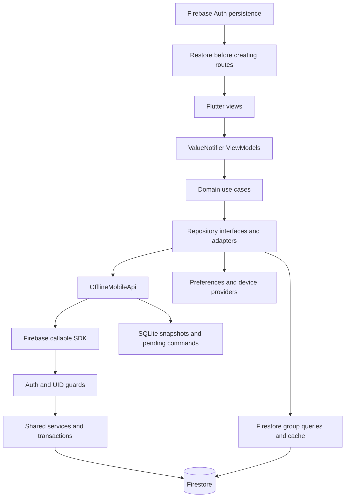
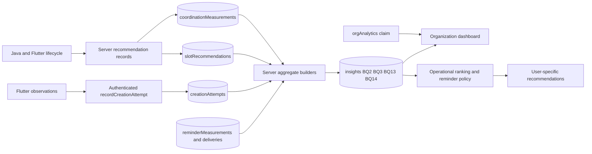

# Architecture and technical strategies

## Layers

Feature-oriented MVVM uses constructor injection, domain use cases and repository interfaces. Views render immutable state with ValueListenableBuilder; ValueNotifier ViewModels coordinate commands. GoRouter route entries own/dispose ViewModels. Runtime composition lives in lib/app/dependency_injection/.

The separate backend validates fields/Auth/clientUserId in mobileCallables.js; services enforce membership, ownership and versions. activityCallables.js exposes recommendation services. Java shares server contracts, not Flutter widgets.

## c. Eventual connectivity

**Where:** core/data/offline_mobile_api.dart, shared/widgets/offline_shell.dart, repository adapters and features/groups/data/data_sources/firestore_groups_data_source.dart.

**Why:** network interfaces do not prove Firebase reachability. Actual transport errors and bounded requests select saved data; authorization/validation failures are not silently converted into successful stale reads.

- Snapshots cover Profile, Alerts, Home activities, opened Activity Details, Friends and loaded Schedule peers/days. Unvisited data has no invented fallback.
- Groups reads Firestore cache offline. Server/cache deadlines are six/two seconds; optional response-time estimates do not block the list. Missing attendance is identified instead of inferred from legacy group RSVP.
- Only activity responses and markAlertsRead are queued by OfflineMobileApi. Disk acknowledgement precedes pending-sync success. Event read/dismiss, friendship/search, participant management, profile/resource/share mutations need connectivity.
- Publication has a separate durable journal: reuse requestId after a lost response. Each network observation has its own attemptId.
- Reconnection, resume and a foreground 30-second timer retry supported work. No replay guarantee exists with the process terminated.
- Temporary transport failure preserves the restored Auth account. Confirmed invalid credentials require login; cached profile content is not an authentication credential.

## d. Local storage

| Mechanism / code | Data and reason | Boundary |
|---|---|---|
| SqliteOfflineStore | offline_accounts, cached_responses, pending_operations; commit the full envelope transactionally | Project/UID namespace, schema 1, migration tests; namespace is not encryption |
| PreferencesOfflineStore | Offline adapter fallback on non-native targets | Not a relational database |
| Preferences journals / Quick Status | Publication recovery, creation observations, manual Free until / Next activity | Small persistent records; manual text does not change shared calendar intervals |
| Firebase Auth SDK | Persisted native account restored before routing | No manually copied session token in LRU/Preferences |
| SecureSavedCredentialsRepository | Optional biometric email/password | Explicit opt-in, flutter_secure_storage; separate from normal restoration and not a hardware security audit |

Clearing app data/uninstalling does not preserve session state. Camera data URLs are not an application-managed persistent image cache. ICS export uses external sharing.

## e. Concurrency and multi-threading

| Mechanism | Placement | Purpose |
|---|---|---|
| Future / async-await / handlers | Repositories, ViewModels and bootstrap | Nonblocking I/O control flow, failure propagation, session/disposal guards |
| Stream | Connectivity and Firebase Auth listeners | React to interface/session changes with explicit subscription lifecycle |
| Serialized Future chain _locked | offline_mobile_api.dart | Prevent lost cache/outbox updates; one failure does not poison subsequent operations |
| Native compute isolates | offline_document_codec.dart | JSON decode ≥32,768 characters; encode ≥8 cache entries or supported lists ≥100 items |
| Transactions / expected versions | Backend social/activity/reminder services | Username uniqueness, consent, idempotency and conflict-safe attendance |

Async I/O is not a CPU thread. Isolates have separate memory: workers serialize snapshots and do not write storage. Web compute does not establish a native background thread. A prior Android emulator smoke processed 50,944 characters; this is not a benchmark or physical-device result.

## f. Caching

**Where:** OfflineMobileApi._remember, _invalidateAfterMutation, SQLite and Firestore group cache.

An insertion-ordered Map implements a persisted LRU of **64 response entries**. A hit changes recency without rejuvenating savedAt. Mutation-specific invalidation removes affected responses. Pending commands overlay snapshots under their original project/UID. Capacity counts entries, not bytes; serializing the envelope has proportional cost.

This is network-first with offline fallback. Cached availability is not a reservation or proof of current state. UI indicators intentionally omit dates; internal metadata remains. The cache does not store passwords, grant permissions or provide persistent image caching.

## Patterns and trade-offs

- **Strategy:** server ActivityService injects the ranker; ContextAwareSlotRankingStrategy and history-aware ranking separate policy from consumers. Java has alternative rankers. BQ13 history only ranks feasible comparable slots with sufficient recent evidence.
- **Repository / Adapter:** Firebase/device/fake implementations satisfy domain contracts. Emulator tests exercise actual persistence; fakes control failures.
- **Observer:** ValueNotifier and streams update views. This does not make every document realtime; Alerts refreshes on entry and while visible.
- **Command / Outbox / idempotency:** durable intent survives failure. requestId, attempt identity and expected versions serve different purposes.
- **MVVM:** existing native observables avoid adding a second state framework; lifecycle/disposal remains explicit.

## Shared analytics boundary

Backend dashboard/ reads aggregates, not raw private profiles. refreshActivityInsights requires orgAnalytics; Firestore aggregate reads require ParchApp sign-in. Callable transport must accept Firebase SDK requests; handlers still authenticate/authorize them. An editable profile flag or browser secret is not authorization. Team aggregators/cards remain independent.

Legacy Java payloads remain accepted, but new Flutter social UI does not automatically exist in Java. Physical cuts, Java↔Flutter UI, biometrics and Calendar need separate acceptance. See [testing](testing.md) and [BQ definitions](business-questions.md).

## Language boundaries: why this Flutter project includes non-Dart files

Application UI, ViewModels, domain logic and repository adapters under lib/ are Dart (220 files at this audit); the test/ directory also contains only Dart test source. Native runners, build configuration and external verification utilities have different responsibilities.

| Files / language | Reason for retaining them |
|---|---|
| android/app/src/main/kotlin/com/example/parchapp/MainActivity.kt / Kotlin | Android host extends FlutterFragmentActivity and exposes the existing Google Places Android SDK through MethodChannel parchapp/google_places. It performs autocomplete/details/session-token integration. This is custom native adapter code, not merely generated boilerplate. Its Dart caller is features/activities/data/data_sources/google_places_source.dart |
| android/*.gradle.kts and android/app/build.gradle.kts / Kotlin DSL | Configure Gradle, Android/Firebase plugins, SDK, dependencies and signing. They are build configuration, not Flutter business logic |
| iOS/macOS AppDelegate, SceneDelegate, MainFlutterWindow and registrants / Swift; bridging header / Objective-C header | Start the Flutter engine, manage native windows/scenes and register plugins. RunnerTests are native harness tests. These do not duplicate Flutter application screens |
| web/index.html / HTML with generated JavaScript bootstrap | Browser entry point loads the compiled Flutter application. A browser cannot load the Dart source as an Android native executable |
| tool/*.cjs / JavaScript (Node) | Five development-only fixture/verification scripts call isolated Firebase emulator HTTP APIs. They do not run inside the mobile application or implement its UI |
| tool/check_quality.ps1 / PowerShell | Developer automation for analysis, tests, coverage and an explicitly configured Sonar scanner. Equivalent commands are documented and may be run manually |
| XML, plist, JSON, YAML and platform resources | Manifest/permissions, Firebase project identifiers, assets, splash/themes and dependency/tool configuration; these are platform formats rather than an alternative application implementation |

The Google Places bridge could be replaced by another tested Flutter integration, but removing it without replacement breaks place search. Moving it into a plugin would still require native platform implementation underneath. No conversion or native-file deletion was performed for this audit. Backend Cloud Functions and dashboard JavaScript are in the separate Backend repository and are not Flutter mobile source.
